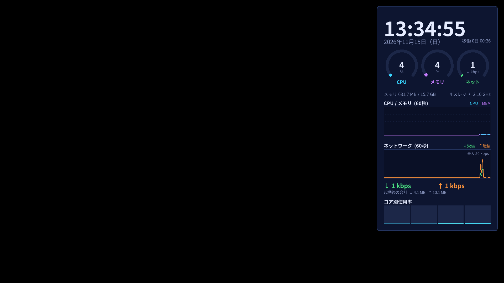

# 動くデスクトップ（デスクトップ用システムモニター） v3

デスクトップの右上に、CPU・メモリ・ネット速度をリアルタイムで表示するウィジェットです。
常に他のウィンドウの後ろ（最背面）に表示されるので、作業の邪魔になりません。背景アニメ付きの全画面表示もできます。



全画面型：


> **Lively Wallpaper を使う場合は [`lively/`](lively/README.md) を使ってください。**
> 新しい Windows 11 でも、アイコンの裏で動く壁紙になります（推奨）。

## 表示する内容
| 項目 | 内容 |
|---|---|
| 背景 | パーティクルのアニメーション。CPU負荷が上がると速くなり、色はシアン→黄→赤に変わる |
| 時計 | 時刻・日付（yyyy年MM月dd日）・PCの稼働時間 |
| ゲージ | CPU% ／ メモリ% ／ ネット受信速度 |
| グラフ | CPU・メモリの直近60秒、ネットワーク受信・送信の直近60秒（目盛りは自動調整） |
| 数値 | 受信速度・送信速度（bps表記）、起動後の合計通信量、メモリ使用量、スレッド数・クロック |
| コア別 | 論理コアごとの使用率バー |

## 必要なもの
- Python 3.8 以降（python.org版を推奨。インストール時に「Add to PATH」にチェックを入れる）
- psutil（start.bat が自動でインストールします）

## 使い方
| ファイル | 動作 |
|---|---|
| `start.bat` | ウィジェット型で起動（右上にパネルだけ表示。アイコンも壁紙も見える） |
| `stop.bat` | 終了（右クリックメニューの「終了」でも止まります） |
| `start_fullscreen.bat` | 背景アニメ付きの全画面で起動（最背面に表示。デスクトップのアイコンは隠れます） |
| `start_window.bat` | 通常ウィンドウで起動（試し見用。Escで終了） |
| `debug.bat` | 診断用。Pythonの状態を確認し、エラーやログを画面に表示する |
| `autostart_on.bat` / `autostart_off.bat` | Windows起動時の自動起動を登録／解除 |

### ウィジェットの操作
- **ドラッグ**：好きな位置へ移動（位置は次回も保持）
- **右クリック**：「位置を右上に戻す」「終了」
- 透明度は `moving_desktop.py` の `WIDGET_ALPHA`（0.3～1.0）で変えられます

## カスタマイズ
`moving_desktop.py` 冒頭の「設定」を書き換えます。
- `FPS`：描画フレームレート（負荷を下げたい場合は 15～20）
- `PARTICLE_COUNT`：背景の粒の数
- `PANEL_SIDE`：パネルの位置（`"right"` / `"left"`）
- 色（`C_CPU` など）

## うまく表示されないとき
1. `debug.bat` を実行し、表示された内容（エラーやログ）を確認します。ログは同じフォルダの `moving_desktop.log` に残ります。
2. Windows 11（24H2以降。確認した環境：10.0.26200）では、壁紙（アイコンの裏）に埋め込むと表示されません。そのため v3 から、標準をウィジェット型にしました。
   壁紙への埋め込みを試す場合は `--wallpaper --method progman|progman-nolayer|workerw` で起動します（古いWindowsでは動く可能性があります）。

## 注意
- 全画面型と壁紙モードは、プライマリモニターに表示します。
- 「デスクトップを表示」（Win＋D）を押すと、ウィジェットも一時的に隠れることがあります。
- CPU負荷の目安は1コアの1割程度です（FPS 30、粒70個、フルHDの場合。テスト環境での実測値）。ノートPCのバッテリー駆動時はFPSを下げることをお勧めします。

## 付録：batファイルの中身（手元で作成する場合）
メモ帳に貼り付け、ファイル名を指定して保存してください（文字コード：UTF-8）。

### start.bat
```bat
@echo off
chcp 65001 >nul
cd /d %~dp0
call :findpy || goto :nopy
%PY% -c "import psutil" 2>nul || %PY% -m pip install --user psutil
if errorlevel 1 goto :fail
rem コンソールを出さずにウィジェット型（パネルだけを最背面に表示）で起動
start "" %PYW% "%~dp0moving_desktop.py" --widget %*
exit /b

:findpy
where py >nul 2>nul && (set "PY=py -3" & set "PYW=pyw -3" & exit /b 0)
where python >nul 2>nul && python -c "import sys" >nul 2>nul && (set "PY=python" & set "PYW=pythonw" & exit /b 0)
exit /b 1

:nopy
echo Python が見つかりません。python.org からインストールしてください（Add to PATH にチェック）。
pause
exit /b 1

:fail
echo psutil のインストールに失敗しました。debug.bat を実行して内容を確認してください。
pause
exit /b 1
```

### start_fullscreen.bat
```bat
@echo off
chcp 65001 >nul
cd /d %~dp0
call :findpy || goto :nopy
%PY% -c "import psutil" 2>nul || %PY% -m pip install --user psutil
if errorlevel 1 goto :fail
rem コンソールを出さずに背景アニメ付きの全画面で起動（デスクトップのアイコンは隠れます）
start "" %PYW% "%~dp0moving_desktop.py" --wallpaper --no-embed %*
exit /b

:findpy
where py >nul 2>nul && (set "PY=py -3" & set "PYW=pyw -3" & exit /b 0)
where python >nul 2>nul && python -c "import sys" >nul 2>nul && (set "PY=python" & set "PYW=pythonw" & exit /b 0)
exit /b 1

:nopy
echo Python が見つかりません。python.org からインストールしてください（Add to PATH にチェック）。
pause
exit /b 1

:fail
echo psutil のインストールに失敗しました。debug.bat を実行して内容を確認してください。
pause
exit /b 1
```

### start_window.bat
```bat
@echo off
chcp 65001 >nul
cd /d %~dp0
call :findpy || goto :nopy
%PY% -c "import psutil" 2>nul || %PY% -m pip install --user psutil
if errorlevel 1 goto :fail
rem コンソールを出さずに通常ウィンドウで起動（Esc で終了）
start "" %PYW% "%~dp0moving_desktop.py" --window %*
exit /b

:findpy
where py >nul 2>nul && (set "PY=py -3" & set "PYW=pyw -3" & exit /b 0)
where python >nul 2>nul && python -c "import sys" >nul 2>nul && (set "PY=python" & set "PYW=pythonw" & exit /b 0)
exit /b 1

:nopy
echo Python が見つかりません。python.org からインストールしてください（Add to PATH にチェック）。
pause
exit /b 1

:fail
echo psutil のインストールに失敗しました。debug.bat を実行して内容を確認してください。
pause
exit /b 1
```

### stop.bat
```bat
@echo off
rem 停止フラグを作成 → 1秒以内に終了して元の壁紙に戻ります
type nul > "%~dp0stop.flag"
```

### debug.bat
```bat
@echo off
chcp 65001 >nul
cd /d %~dp0
echo === 動くデスクトップ 診断 ===
set "PY="
where py >nul 2>nul && set "PY=py -3"
if not defined PY where python >nul 2>nul && set "PY=python"
if not defined PY (echo Python が見つかりません & pause & exit /b 1)
echo 使用するPython: %PY%
%PY% --version
%PY% -c "import psutil; print('psutil', psutil.__version__)"
%PY% -c "import tkinter; print('tkinter OK')"
echo.
echo --- ウィジェット型で起動します（エラーがあればここに表示されます。終了は stop.bat） ---
%PY% "%~dp0moving_desktop.py" --widget
echo.
echo --- ログ（moving_desktop.log の最後の部分） ---
powershell -NoProfile -Command "Get-Content -Tail 30 -Encoding UTF8 '%~dp0moving_desktop.log'"
pause
```

### autostart_on.bat
```bat
@echo off
chcp 65001 >nul
rem Windows起動時に自動で動くデスクトップを開始（スタートアップにショートカットを作成）
powershell -NoProfile -Command "$s=(New-Object -ComObject WScript.Shell).CreateShortcut([Environment]::GetFolderPath('Startup')+'\MovingDesktop.lnk');$s.TargetPath='%~dp0start.bat';$s.WorkingDirectory='%~dp0';$s.WindowStyle=7;$s.Save()"
echo スタートアップに登録しました。
pause
```

### autostart_off.bat
```bat
@echo off
chcp 65001 >nul
powershell -NoProfile -Command "Remove-Item -ErrorAction SilentlyContinue ([Environment]::GetFolderPath('Startup')+'\MovingDesktop.lnk')"
echo スタートアップから解除しました。
pause
```
