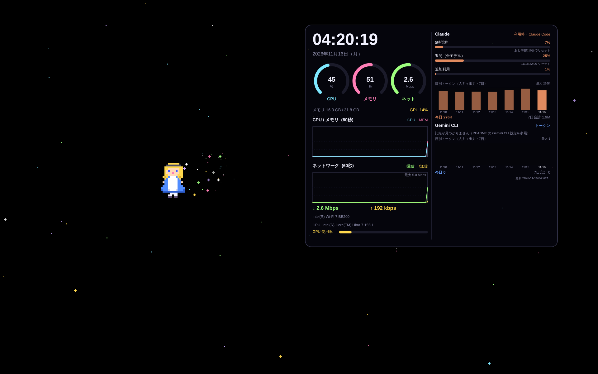

# 動くデスクトップ（Lively Wallpaper 版） v6

[Lively Wallpaper](https://www.rocksdanister.com/lively/)（無料・Microsoft Store から入手可）で動かす版です。
Lively が壁紙の埋め込みを担当するので、Windows 11 の新しいバージョンでもデスクトップのアイコンの裏で正しく動きます。



## 表示する内容
- 背景（標準）：黒い宇宙にまたたく星と、アリス風の女の子のドット絵（オリジナル）。CPU負荷が上がると速く歩き、キラキラが増える
- 背景（切替可）：`CFG.theme` を `"network"` にすると、CPU負荷で速さと色が変わる粒と線の背景
- 時計・日付
- CPU％ / メモリ％ / ネット受信速度のゲージ
- CPU・メモリ、ネット（↓受信 ↑送信）の60秒グラフ
- メモリ使用量、GPU使用率、CPU名・ネットワークアダプター名
- **AI 使用量**（v3で追加。付属の `ai_usage_collector.py` を動かしたとき）
  - Claude の利用枠：5時間枠・週間枠の使用率％と、リセットまでの時間（claude.ai と Claude Code 共通の枠）
  - Claude Code・Gemini CLI それぞれの日別トークン（直近7日、目盛りは別々）と今日・7日合計

CPU などの値は Lively の System Data API（`livelySystemInformation`）から約1秒ごとに受け取ります。
Lively 以外（ブラウザ）で `index.html` を開いた場合は「デモ表示」と出て、仮の値で動きます。

## 導入手順
1. Microsoft Store で「Lively Wallpaper」をインストールします。
2. ZIP を PC の任意のフォルダ（例：`C:\Tools\動くデスクトップ_Lively`）に展開します。
3. Lively を起動し、左上の「＋」（壁紙を追加）から、**同じZIP** を選びます（ドラッグ＆ドロップでも可）。
4. ライブラリの「動くデスクトップ」をクリックすると、壁紙に設定されます。
5. AI 使用量を表示する場合は、展開したフォルダの `ai_usage_start.bat` を実行します。
   - 1分ごとに集計し、Lively のライブラリ内の壁紙フォルダを自動で探して `usage.js` を書き出します。
   - 最初は `ai_usage_check.bat` で、値が取れているか確認すると安心です。
   - 毎回自動で動かす場合は `ai_usage_autostart_on.bat` を実行します。

## AI 使用量の取得元
| 項目 | 取得元 | 必要なこと |
|---|---|---|
| Claude 利用枠（5時間・週間） | Claude Code のログイン情報で Anthropic に問い合わせ（Claude Code の `/usage` と同じ情報源） | PCの Claude Code にログインしていること |
| Claude Code の日別トークン | `%USERPROFILE%\.claude\projects\` のログ | なし |
| Gemini CLI の日別トークン | `%USERPROFILE%\.gemini\tmp\*\chats\` の会話記録、またはテレメトリ出力 | 下記参照 |

- Claude 利用枠の取得方法は公開仕様ではないため、将来の更新で取れなくなる可能性があります。その場合も他の表示は動きます。
- ログイン情報は Anthropic への問い合わせにだけ使い、`usage.js` やログには書き出しません。
- Gemini CLI で値が出ない場合は、`%USERPROFILE%\.gemini\settings.json` に次を追加してください（プロンプト本文は記録しない設定です）。
  ```json
  "telemetry": { "enabled": true, "target": "local", "outfile": "C:\\Users\\<ユーザー名>\\.gemini\\telemetry.log", "logPrompts": false }
  ```
- 金額ではなく**トークン量**を表示します（定額プランでは利用量に応じた請求がないため）。

## AI 使用量のファイル
| ファイル | 内容 |
|---|---|
| `ai_usage_collector.py` | 集計プログラム（Python標準ライブラリのみ。追加インストール不要） |
| `ai_usage_start.bat` / `ai_usage_stop.bat` | 常駐起動／終了 |
| `ai_usage_check.bat` | 1回だけ集計して内容を表示（動作確認用） |
| `ai_usage_autostart_on.bat` / `_off.bat` | Windows起動時の自動起動を登録／解除 |

## カスタマイズ
`index.html` 冒頭の `CFG` と `C`（色）を書き換えます。
| 項目 | 内容 |
|---|---|
| `layout` | パネルの形（`"wide"`＝横長2列：左にPC・右にAI / `"tall"`＝縦長1列） |
| `theme` | 背景の種類（`"pixel"`＝ドット絵の女の子 / `"network"`＝粒と線） |
| `fps` | 描画の上限（標準30。下げるほど軽い） |
| `particles` | 背景の粒の数（減らすほど軽い） |
| `panelScale` | パネルの大きさ（標準0.9） |
| `fontScale` | 小さい文字の拡大率（標準1.2） |
| `panelMarginX` / `panelMarginY` | 画面の端・上からの距離（デスクトップのアイコンを避ける） |
| `panelSide` | パネルの位置（`"right"` / `"left"`） |
| `showAI` | AI 使用量を表示するか（`true` / `false`） |
